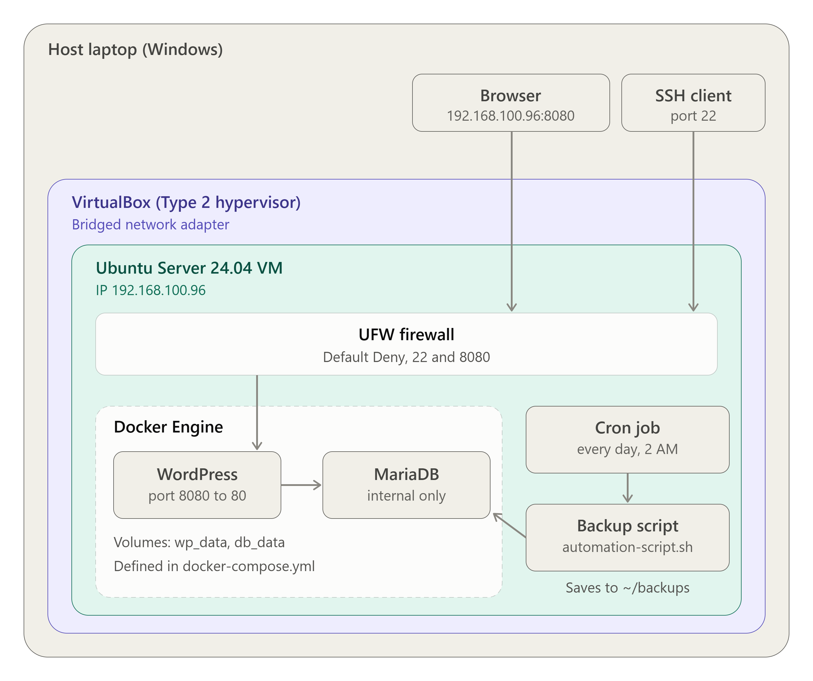

# Laboratory Activity 10: The Enterprise Cloud Architect
## Mission Overview
For the final mission, I acted as the Enterprise Cloud Architect for CloudNova Technologies. The brief was to design, deploy, secure, automate, and document a production-style private cloud with no step-by-step instructions. I built a two-tier WordPress + MariaDB application on an Ubuntu Server virtual machine running in VirtualBox, deployed it with Docker Compose, locked it down with a UFW firewall, and added an automated nightly database backup scheduled with cron. The system is documented in an operational manual so a client's IT team can deploy, secure, and maintain it.
## Objectives
- Conceptualize and diagram a custom enterprise cloud infrastructure
- Provision and configure a local virtual machine running a headless Linux distribution (Ubuntu Server)
- Install and configure Docker and Docker Compose on a fresh operating system
- Deploy a multi-tier containerized application with persistent data volumes
- Implement system security and port management independently
- Automate an operational task using a Bash script and a cron job
- Synthesize all technical documentation into a professional GitHub portfolio
- Demonstrate and defend the infrastructure live
## Architecture Summary
| Layer | Implementation |
|---|---|
| Host | Laptop (browser and SSH client) |
| Hypervisor | VirtualBox (Type 2), Bridged Adapter networking |
| Virtual machine | Ubuntu Server 24.04 LTS (headless), hostname `ccm101`, IP `192.168.100.96` |
| Firewall | UFW with Default Deny, allowing only ports 22 and 8080 |
| Container platform | Docker Engine and Docker Compose |
| Web tier | WordPress container, published on port 8080 |
| Database tier | MariaDB 10.11 container, not published to the network |
| Persistent storage | Docker volumes `db_data` and `wp_data` |
| Automation | `automation-script.sh` scheduled by cron at 2:00 AM daily |

## Requirements Checklist
| Requirement | What I Built |
|---|---|
| 1. Base infrastructure and architecture design | Architecture diagram, VirtualBox VM with Ubuntu Server, bridged networking so the host browser and SSH reach the server |
| 2. Infrastructure integration (deployment) | `docker-compose.yml` with two linked containers (WordPress and MariaDB) and persistent volumes for data |
| 3. Security configurations (hardening) | UFW enabled with Default Deny; only SSH (22) and the application (8080) allowed |
| 4. Automation scripts | `automation-script.sh` backs up the database to a compressed file, removes backups older than 7 days, and runs from a cron job at `0 2 * * *` |
| 5. Technical documentation | Operational manual, final reflection, and this README, all in the repository |
## Tools Used
- VirtualBox (Type 2 hypervisor)
- Ubuntu Server 24.04 LTS
- OpenSSH
- Docker Engine and Docker Compose
- WordPress and MariaDB container images
- UFW (Uncomplicated Firewall)
- Bash and cron
- draw.io (architecture diagram)
- GitHub (documentation and code)
## Key Commands Executed
### Access
```bash
ssh ccm101@192.168.100.96
hostname -I
```
### Deployment
```bash
docker compose pull
docker compose up -d
docker compose ps
docker volume ls
```
### Security
```bash
sudo ufw allow 22/tcp
sudo ufw allow 8080/tcp
sudo ufw default deny incoming
sudo ufw default allow outgoing
sudo ufw enable
sudo ufw status verbose
```
### Automation
```bash
chmod +x automation-script.sh
./automation-script.sh
ls -lh ~/backups
crontab -e
crontab -l
```
## Repository Contents
| File | Description |
|---|---|
| [`README.md`](README.md) | Overview of the project (this file) |
| [`architecture-diagram.png`](architecture-diagram.png) | Network and architecture diagram |
| [`docker-compose.yml`](docker-compose.yml) | Infrastructure as Code for the WordPress + MariaDB stack |
| [`automation-script.sh`](automation-script.sh) | Database backup and rotation script |
| [`operational-manual.md`](operational-manual.md) | Handover manual for the client's IT team |
| [`final-reflection.md`](final-reflection.md) | Reflection on Missions 1 to 10 |
## Skills Learned
In this project I learned how to provision a virtual machine and install Ubuntu Server without a guided lab environment, and how to reach it from my host laptop over SSH and a browser. I learned to deploy a multi-container application with Docker Compose, and why a persistent volume keeps database data safe when containers are removed. I also learned to harden a server by setting UFW to Default Deny and opening only the ports the application needs, and to automate a backup with a Bash script and a cron schedule. Finally, I practiced writing documentation that another engineer can follow to rebuild the system.
